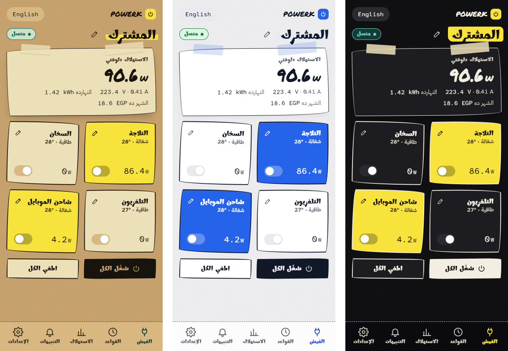
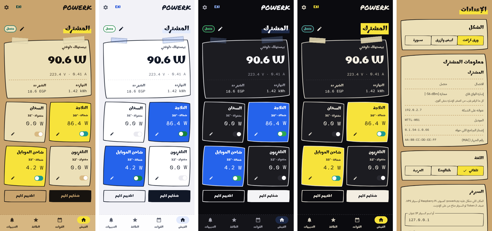
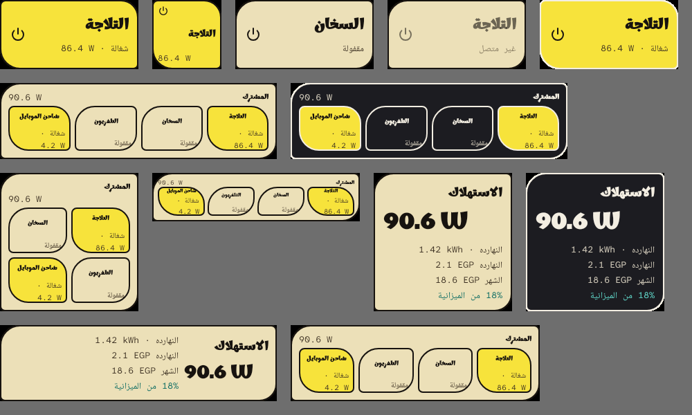

# powerk cloud

Self-hosted control for the LG U+ / Jinheung **MTTL-W01** four-outlet smart power strip.
It replaces the vendor cloud with your own server, a web app and an Android app.



## Features

- **Accounts and sharing.** Sign in with a phone number and password. Claim a strip with
  its setup code and a button press. Share it as owner, control or viewer.
- **Rules on the server.** Schedules, timers, on/off cycles and auto-off on low power.
  They run even when your phone is off.
- **Energy.** Day, week, month and year history, cost at your kWh price, and a monthly
  budget with alerts at 50%, 75%, 90% and 100%.
- **Alerts.** Strip offline, high temperature, high power and budget steps, sent by
  ntfy, Telegram or Android push (FCM).
- **Live updates.** Outlet state streams over WebSocket to the web and Android apps.
- **Web UI.** Arabic and English, three themes, and bundled fonts, so it works offline.
- **Android app.** The same screens and themes, three home-screen widgets and a
  Quick Settings tile. Tokens are stored encrypted with Android Keystore.
- **Security.** Argon2id passwords, rotating refresh tokens with reuse detection, rate
  limits, a strict CSP and a per-account security log.
- **Deployment.** Docker Compose with Caddy behind Cloudflare (Authenticated Origin
  Pulls) and daily backups that keep the last 14 snapshots.

| Android app | Home-screen widgets |
|---|---|
|  |  |

*Screenshots use demo data.*

## How it works

```text
phone / browser -- HTTPS --> Cloudflare -- HTTPS --> Caddy --> powerk server
                                                                   ^
                                                                   | TCP 10086
                                                                 strip
```

You write your server's IP address into the strip once. The strip then connects out
to the server on TCP 10086, so you need no port forwarding at home and no firmware
changes.

| Part | Stack |
|---|---|
| Server | Python 3.11+, FastAPI, SQLite, WebSocket, FCM (`server/`) |
| Web UI | HTML, CSS and plain JavaScript (`server/powerk/web/`) |
| Android | Kotlin, Jetpack Compose, Material 3, Android 8.0+ (`android/`) |
| Deploy | Docker Compose, Caddy, Cloudflare, host firewall (`deploy/`) |
| Provisioner | One Python standard library script (`tools/provision.py`) |

## Quick start

Run the server locally:

```sh
cd server
python -m venv .venv
source .venv/bin/activate        # Windows: .\.venv\Scripts\Activate.ps1
python -m pip install -e ".[test]"
python -m powerk serve --data ./data
```

Open `http://localhost:8080` and create an account.

Connect a strip:

1. Hold the strip's main button for about 10 seconds, until the LED blinks fast.
2. Join the `TONLY_TAP_XXXXXXX` Wi-Fi network.
3. Run:

   ```sh
   python tools/provision.py --ip <SERVER-IP> --ssid "YOURWIFI" --password "YOURWIFIPW"
   ```

4. In the app, choose **Add a strip**, type the seven characters from the network name,
   and press any button on the strip within 60 seconds.

For a public HTTPS server, follow the [deployment guide](deploy/README.md).

## Documentation

| Document | Contents |
|---|---|
| [GUIDE.md](GUIDE.md) ([العربية](GUIDE.ar.md)) | Full guide: setup, sharing, rules, security, troubleshooting |
| [deploy/README.md](deploy/README.md) | Docker, Cloudflare, certificates, firewall, backups, rollback |
| [server/README.md](server/README.md) | Server CLI, accounts and migration |
| [android/README.md](android/README.md) | Android setup and builds |
| [API.md](API.md) | HTTP, WebSocket and FCM reference |

## Tests

```sh
cd server && python -m pytest tests -q && node --test tests/
cd android && ./gradlew testDebugUnitTest
```

507 Python tests, 43 JavaScript tests and 171 Android unit and screenshot tests.

## Credits

Based on [powerk](https://github.com/ahmedtohamy1/powerk) by Ahmed Tohamy, which
documented the strip's protocol and provided the first server. This repository adds
accounts, sharing, the FastAPI server, live updates, the new web and Android apps,
and the Docker deployment.
